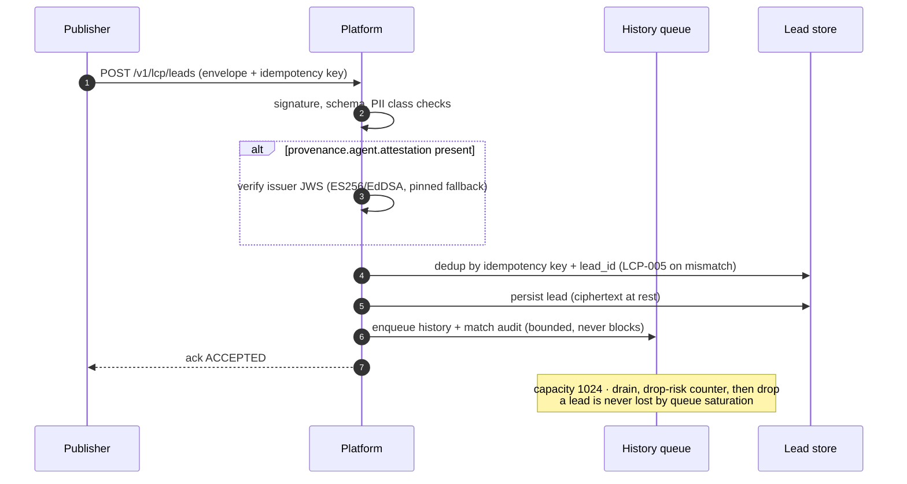
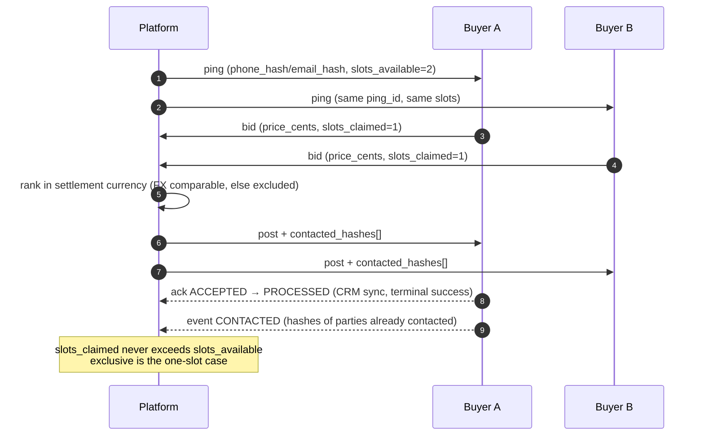
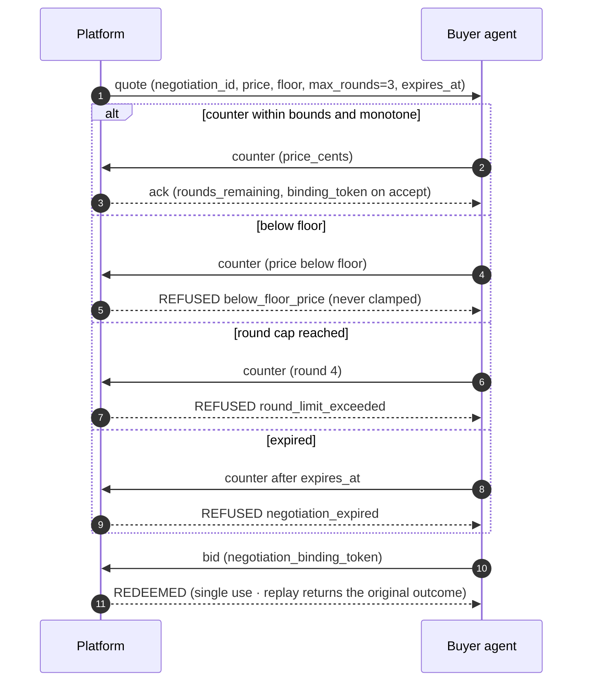
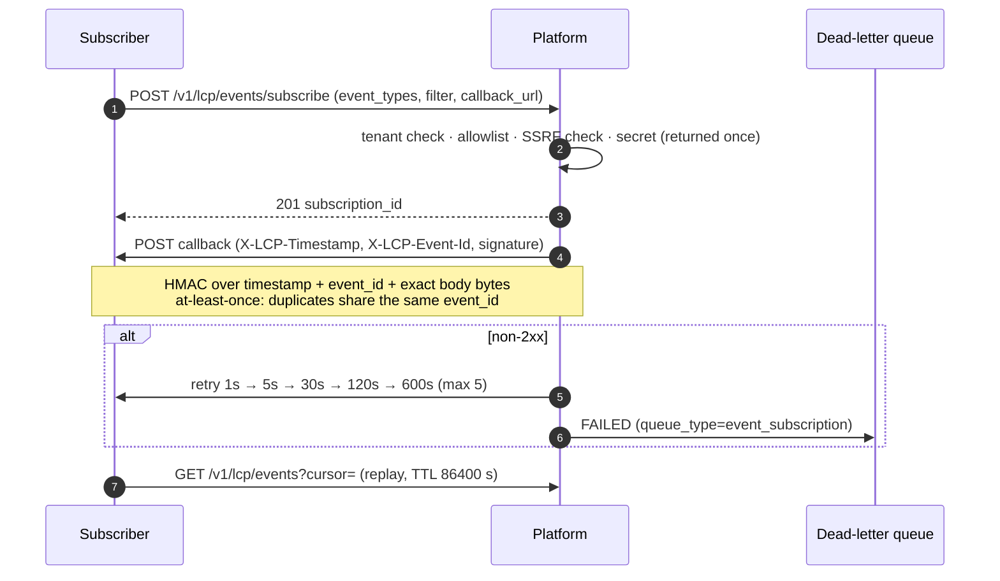
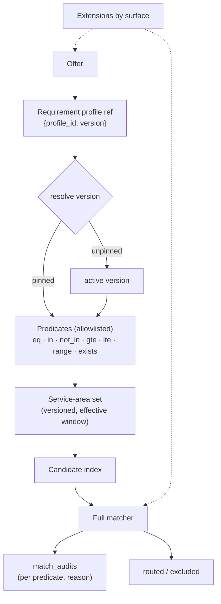
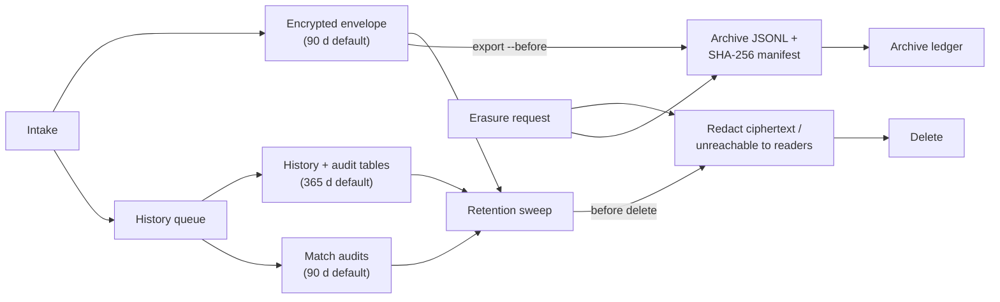

# LCP capability map

> **Reader page · how the pieces talk.** Normative behaviour lives in
> [`spec/`](../spec/); this page only draws the shapes the prose describes.
> Each diagram names the capability gate that must be advertised before the
> surface exists for a peer (`spec/05-capabilities.md` §8).

LCP is one wire contract with several distinct topologies on top of it. The
system map that introduces them lives in the [README](../README.md); the six
diagrams below run from intake to what happens to the data afterwards. They are
deliberately small: if a flow needed more than a dozen nodes, it is two flows.

---

## 1. Intake — what happens to one lead

Gate: none. Batch uses the same path per item (`features.batch`, off by
default); see diagram 3 for routing.

## 2. Auction and shared slots

Gate: slots are part of the 1.1 baseline. Cross-currency ranking needs
`features.multi_currency` and a fresh, consistently-sourced rate
(`LCP_FX_MAX_AGE_SECONDS`, default 300); otherwise the offer is
non-comparable and excluded with a reason.

## 3. Agent-to-agent negotiation

Gate: `features.negotiation` (`LCP_FEATURE_NEGOTIATION`, off by default).
A peer that does not advertise it gets `LCP-006` for `quote`/`counter`, not a
silent downgrade.

## 4. Event subscriptions

Gate: `features.event_subscriptions` (`LCP_FEATURE_EVENTS`, off by default).
Filters are closed to core enums and identifiers — a consumer field is refused
by name.

## 5. Profiles, matching, and extension admission

Limits: ≤50 predicates, ≤100 values per set, typed paths only. An unknown
path or operator is refused when the profile is written, not at match time.
Offers keep the version they were created with, so activation and rollback
never rewrite history.

Extension admission is surface-scoped:

| Surface | Admits |
|---|---|
| `ping` | only registrations declaring ping safety (`lcp.platform.assessment`) |
| `lead` / `post` | `lcp.form.questions`, `lcp.intake.raw_form` (`restricted`), `lcp.platform.assessment` |
| `offer` | `lcp.platform.requirements`, `lcp.platform.service_area`, `lcp.buyer.criteria` |
| `event` | `lcp.marketplace.final_pricing`, `lcp.outbound.call_request` |

## 6. Data lifecycle — retention, archive, erasure

Retention defaults are configuration, not policy: `LCP_ENVELOPE_RETENTION_DAYS`
(90) and `LCP_HISTORY_RETENTION_DAYS` (365). Exports refuse rows in the
erasure set, and every archive digest is recorded so an erased subject can be
accounted for after the live row is gone.

---

## Reading order

| If you are… | Start at |
|---|---|
| a publisher | 1 (intake) → 6 (retention) |
| a buyer | 2 (auction) → 3 (negotiation) → 4 (events) |
| a platform operator | README map → 5 (matching) → 6 (lifecycle) |
| an agent integrator | README map → 3 → 1 |

**Previous:** [SPEC index](../SPEC.md) · **Next:** [Platform integration](PLATFORM-INTEGRATION.md)
