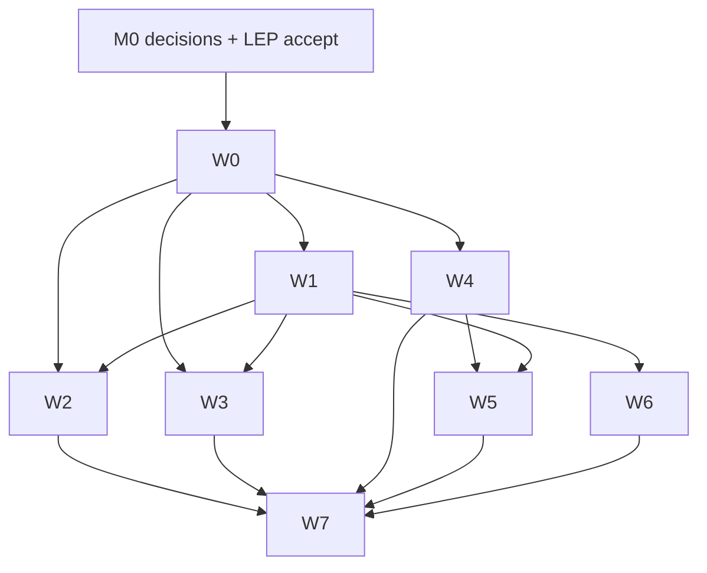

# LCP v1.2 execution plan — clearing the backlog

> **Status:** Draft — awaiting maintainer `go` (plan mode stop-point).
> **Owner:** maintainer (randybeno). Agents implement; they never mark a LEP
> Accepted, never tag, never publish.
> **Supersedes:** the deferred-work sections of [V1.1-ROADMAP](V1.1-ROADMAP.md),
> the open rows of [SPEC §14](../SPEC.md#14-review-log-appendix), the LEP
> follow-up lists in [LEP-REGISTRY](../governance/LEP-REGISTRY.md), and the
> residual rows of [AUDIT-2026-11](AUDIT-2026-11.md).
> **Scope:** every remaining roadmap item — Phase 2, Phase 3, Phase 4, Phase 5
> residuals, Phase 6 remainder, SPEC §14 open + deferred-trigger rows, LEP
> follow-ups, audit residuals, and the governance/DX surfaces — with no item
> left as "later".

## 0. Premise: the triggers are being waived, and that is recorded

Every deferred row in the v1.1 roadmap is **trigger-gated**: the trigger is
unmet today, and `LEP-0001`/`LEP-0007` were Deferred by the ARB on exactly that
basis. This plan does not pretend the triggers were met. It records a
**maintainer waiver** (a dated decision in the LEP registry), and compensates
with three structural constraints so waiving a trigger cannot silently damage
the protocol:

1. **Additive-only wire.** Every protocol change is a MINOR addition, opt-in,
   and advertised through `capabilities()`. A 1.0.0 or 1.1.x peer must never
   see a changed byte, a new required field, or a new rejection it could not
   anticipate.
2. **Off by default.** New surfaces ship disabled (`LCP_FEATURE_*` config,
   default `off`) and are exercised in CI and the conformance suite regardless.
   Nothing becomes load-bearing for existing adopters by upgrading.
3. **Evidence stands in for adoption.** Each waived trigger gets a
   deterministic benchmark, vector, or fixture that would have been the
   adopter evidence, plus a documented re-evaluation date. The waiver says
   "we chose to build it now", not "the need was proven".

Agents may draft, implement, test, and document a LEP. Only the maintainer
moves it to Accepted (LEP process, and the ARB charter's agents-never-Accept
rule). This plan therefore has **one hard human gate: M0**.

## 1. Release shape

| Release | Content | Rationale |
|---|---|---|
| `v1.2.0` | All additive wire items: W1 + W2 + W3 + W6 protocol-facing (PII taxonomy annotations, outbound-call extension, multi-currency, PROCESSED) | One MINOR bump; adopters integrate once |
| `v1.2.0` (same tag) | Platform-only depth: W4 (profiles, service areas, retention, async history), W6-DX (spec site, split SPEC, hosted conformance), MCP throughput | No wire change; ships in the container image |
| `v1.3.0` | W5 agent-to-agent negotiation **only if** M0 accepts it as a new message-type surface | Adds `quote`/`counter` to a closed enum — a larger semantic step than the rest of the plan |

If W5 is not accepted at M0, its schema/state-machine design still lands as a
registered LEP with a Design-Completed status, and it is the only item allowed
to slip. Everything else lands in `v1.2.0`.

## 2. Invariants that bind every wave

| # | Invariant | Enforced by |
|---|---|---|
| I1 | `schemas/` is the only normative source; platform, OpenAPI, MCP, SDKs and vectors are generated or verified against it | `check-schema-sync`, `check-openapi`, schema-sync CI |
| I2 | No wire change without: vector (positive + negative), conformance test, OpenAPI, MCP contract, SDK helper, compatibility note | change gates in SPEC §12/§13 |
| I3 | `ping` stays `ping_safe`; any new PII field is post-only and `never in ping` asserted by vector | `ping_safe` metadata + negative vectors |
| I4 | Deliveries are at-least-once; every new delivery surface carries a stable ID and a replay/receipt story | platform tests + event vectors |
| I5 | Coverage matrix stays at **0 unexplained gap**; exemptions need a dated decision and an owner | `--fail-on-gap` (blocking) |
| I6 | Every new endpoint has tenant authorization tests (buyer sees only its rows) | platform test suite (`test_tenant_isolation`) |
| I7 | No new dependency without an entry in `docs/DEPENDENCY-DECISIONS.md` | review |
| I8 | Retention/erasure behaviour is defined before a surface can store new data | PR checklist + W4-06 |

## 3. Decisions the maintainer must sign at M0

Each row is a recommendation with the tradeoff. M0 is one review pass, not a
per-PR ritual; it authorizes the plan, not the releases.

| ID | Decision | Recommendation | Why |
|---|---|---|---|
| D1 | Waive all triggers as a batch, dated | Yes, one registry entry per waived trigger | Honest and auditable; avoids re-litigating per PR |
| D2 | `PROCESSED` ack status semantics | Add to the ack enum **and** the lifecycle: `ACCEPTED → PROCESSED` is a terminal-success transition; `PROCESSED` never re-opens a payable | Fulfils the CRM-sync gap without touching money semantics |
| D3 | `core_schema_version` | **Document** that `lcp.version` *is* the core schema version and expose `core_schema_version` in `capabilities()`; no envelope field | Zero wire surface; the finding is resolved by clarity, not a field nobody would populate |
| D4 | `street_address` home | `location.street_address`, optional, `ping_safe: false` | Matches the finding; keeps vertical sparsity |
| D5 | Raw IP | `provenance.ip_address`, post-only; `ip_hash` remains the ping-safe form | Fraud/geo-validation without widening ping PII |
| D6 | Raw form | Registered extension `{org}.intake.raw_form` (post-only, never ping) | Keeps dispute evidence out of the core; aligns with LEP-0006 |
| D7 | Multi-currency | `pricing.currency` (settlement) + `original_price_cents` + `fx_rate` + `fx_source` + `fx_timestamp`; **auction refuses cross-currency comparison without a valid, non-stale rate** | Never compares raw minor units across currencies |
| D8 | Negotiation surface (W5) | New `quote`/`counter` message types, bounded rounds, signed, ping-safe, floor/ceiling, expiry | Only clean way to express bilateral price discovery; LEP-0009 |
| D9 | PII taxonomy | `docs/PII-CLASSES.md` + `x-lcp-pii` annotation on every schema property + validator that refuses a class downgrade | Turns "formal taxonomy" into a machine-checked invariant |
| D10 | SPEC split | Split at the documented threshold (1303 lines > ~1000) into 5 normative documents + `SPEC.md` index | Trigger is already met |
| D11 | Hosted conformance | Ship a self-hostable runner service + optional hosted deployment; no certification claim until a second operator runs it | Avoids a single-vendor certification monopoly |
| D12 | Second maintainer | Prepare `CODEOWNERS`, `require_extra_approval=false`, and the 1-approval ruleset change; **do not** claim independent approval until a human exists | Human-blocked; the doc must keep saying so |

## 4. Work breakdown

Each item lists **contract** (what is normative), **acceptance** (the observable
result), and **gate** (the check that fails loudly if it regresses).

### W0 — Decisions and scaffolding *(blocks everything; no code)*

| ID | Item | Acceptance | Gate |
|---|---|---|---|
| W0-01 | M0 decision pass: D1–D12 recorded in `governance/LEP-REGISTRY.md` + `docs/DECISIONS-v1.2.md` | Dated decisions, each naming trigger, waiver, re-evaluation date | registry checker |
| W0-02 | LEP records: revive 0001 (batch/events), 0007 (outbound call); new 0009 (negotiation), 0010 (multi-currency), 0011 (PII taxonomy), 0012 (event subscriptions split from 0001 if review wants it) | Each LEP has Contract/Tests/Compatibility/Alternatives at Draft; M0 moves them to Accepted | `check_lep_registry.py` |
| W0-03 | Capability spine: `capabilities().features` map (`{"batch": "1.2.0", …}`) so one advertisement governs every new surface | A 1.0 peer reads an unchanged core block; unknown keys are additive | conformance vector |
| W0-04 | Tracking: this document becomes the living board (status column below) | Every item has an owner lane and a status | review |

### W1 — Core contract additions *(small, unblocks W2/W3; parallel-safe)*

| ID | Item | Contract | Acceptance / gate |
|---|---|---|---|
| W1-01 | `PROCESSED` ack status (D2) | `ack.status` enum + SPEC §3 lifecycle row + OpenAPI/MCP + `POST /v1/lcp/acks` accepts it | vector: `PROCESSED` accepted, illegal transition rejected; pending-payable unaffected |
| W1-02 | `core_schema_version` (D3) | SPEC §2 text + `capabilities().core_schema_version` | capability test; docs citation checker |
| W1-03 | `location.street_address` (D4) | optional string, `ping_safe: false` | positive vector; negative: ping with street address fails |
| W1-04 | `provenance.ip_address` (D5) | post-only IPv4/IPv6, format-validated, `ping_safe: false` | vectors v4/v6/reject; ping negative |
| W1-05 | `{org}.platform.assessment` (quality score) | extension registration: score 0–100, edition/version, explainability fields; ping-safe (no PII) | extension policy test; ping vector accepted |
| W1-06 | `{org}.buyer.criteria` | offer-only extension, allowlisted predicates referencing W4-02 operators | offer validation test; ping rejection when misplaced |
| W1-07 | `{org}.intake.raw_form` (D6) | post-only, size-capped, PII-classed `restricted`, never emitted | vector accepted; ping negative; redaction test |
| W1-08 | `{org}.outbound.call_request` (LEP-0007) | event value + `rejection_reason: "ignored"` known value; no schema addition | LEP-0007 vectors D1–D6 executable |
| W1-09 | Multi-currency pricing (D7) | new `pricing` fields; ranking rule in SPEC §8; stale rate → `LCP-014` (or documented existing code) | vectors: single-currency unchanged, cross-currency no-rate rejected, stale rate rejected, rounding deterministic |
| W1-10 | Exclusivity default (design note from Phase 6) | Documented decision in SPEC §3; **no behavioural change**; `capabilities().exclusivity_default` | docs test |
| W1-11 | SDK typed extension models (LEP-0006 follow-up) | Generated types for registered extensions in all 10 SDKs, additive, unknown-preserving | schema-sync + per-SDK compile/test |
| W1-12 | R1 OpenAPI pattern-equivalence vector (LEP-0005 follow-up) | Vector asserting OpenAPI pattern == JSON Schema pattern for history filters | conformance run |

### W2 — Bounded batch submission *(LEP-0001 revival)*

| ID | Item | Contract | Acceptance / gate |
|---|---|---|---|
| W2-01 | REST `POST /v1/lcp/leads/batch` | `items[]` (max 100 / 1 MiB body), per-item `lead_id`+`idempotency_key`, per-item ack, `207` partial success, **no cross-item transaction** | vectors: all-valid, partial, duplicate-item, oversize, per-item validation error, replay returns original acks |
| W2-02 | Platform execution model | Per-item isolation: one failure never rolls back siblings; batch is a loop over the single-item path, not a new ingestion engine | test asserts sibling persistence after an induced failure |
| W2-03 | MCP `submit_leads_batch` | Same contract, returns per-item acks in input order | MCP contract test |
| W2-04 | SDK helpers ×10 | `submit_leads_batch` with per-item result types, no retry amplification (retries only failed items) | per-SDK tests; interop vector |
| W2-05 | Throughput evidence | Benchmark: batch vs sequential at 100 items, documented in `docs/OPERATIONS.md` | `performance.yml` artifact, non-publishing |

### W3 — Event subscriptions *(push delivery; LEP-0001 second half)*

| ID | Item | Contract | Acceptance / gate |
|---|---|---|---|
| W3-01 | Registration `POST/GET/DELETE /v1/lcp/events/subscribe` | Tenant-scoped; explicit event allowlist (core + registered); per-subscription secret; deactivation; no wildcard by default | authz tests: cross-tenant 403, unknown event 400, secret never returned |
| W3-02 | Delivery semantics | Signed at-least-once with `X-LCP-Signature` over the LEP-0002 canonical input; stable `event_id`; retry with backoff; dead-letter after N; at-least-once duplicates allowed and documented | tests: duplicate delivery, retry, DLQ, signature verification, clock skew |
| W3-03 | Replay/cursor | `?cursor=` on `GET /v1/lcp/events` plus `replay_from` subscription parameter; cursor expiry documented | test: replay produces identical event set; expired cursor → explicit error |
| W3-04 | Privacy-safe filters | Filter keys restricted to core enums/IDs (type, vertical, status, lead_id); arbitrary consumer fields refused | negative vector: filter on `consumer.email` rejected |
| W3-05 | MCP `subscribe_to_events` + SDK helpers ×10 | Registration + poll fallback parity | contract + interop tests |
| W3-06 | Ops surface | `lcp-platform subscriptions list/show/disable`, DLQ inspection, docs | CLI tests + docs citation |

### W4 — Platform depth *(Phase 2 + Phase 4; no wire change)*

| ID | Item | Contract | Acceptance / gate |
|---|---|---|---|
| W4-01 | Requirement-profile store | Versioned profiles, effective-from/to, activation + rollback, immutable identity copied into offers, explainable match audit records | DB tests: rollback restores prior behaviour; audit row per match decision |
| W4-02 | Predicate language | Allowlisted operators (`eq, in, not_in, gte, lte, range, exists`), typed path registry, no expressions, explicit depth/count limits, explainable failures | property tests; refusal of unknown path/operator; perf ceiling test |
| W4-03 | Service-area datasets | Named versioned sets (countries/regions/postal), source identity, effective time, audit; loader + validation; polygons explicitly out | dataset tests; unknown set rejected; version drift detected |
| W4-04 | Candidate index | Maintain the denormalized index; extend keys (vertical, country, category, region, service-area set) | recall parity test: indexed result set ⊇ fallback; benchmark thresholds |
| W4-05 | Async history/audit writes | Hot intake path does not block on history; bounded queue with backpressure and loss policy | test: queue saturation degrades safely, never loses the lead record |
| W4-06 | Retention/archival/partitioning | Retention config for encrypted envelopes + decision history; monthly partitions (PG) / segmented files (SQLite); archive exporter; erasure covers archives | test: expired rows unreachable, archive restores, erasure propagates |
| W4-07 | Postgres capacity in CI | Benchmarks run with thresholds; results published as artifacts | `performance.yml` green with baseline row in `docs/OPERATIONS.md` |
| W4-08 | Negotiation state store (only if D8 accepted) | Quote/counter rounds, expiry, floor/ceiling, final-price binding | W5 tests |

### W5 — Agent-to-agent negotiation *(LEP-0009; only item allowed to slip)*

| ID | Item | Contract | Acceptance / gate |
|---|---|---|---|
| W5-01 | Wire: `quote`/`counter` message types | Ping-safe, signed, bounded rounds (`max_rounds` default 3), absolute expiry, integer cents only, no PII, refusal is explicit | vectors: round exhaustion, expired quote, price below floor, non-monotonic counter |
| W5-02 | Binding | An accepted counter produces a `bid`-equivalent token usable once; replay is idempotent | test: token reuse returns the original outcome |
| W5-03 | Platform state machine | Quote lifecycle in DB with audit; negotiation history obeys W4-06 retention | state-transition tests + erasure test |
| W5-04 | Surfaces | MCP tools + SDK helpers for all 10 SDKs | interop vector |

### W6 — DX, taxonomy, governance *(Phase 5 residuals + Phase 1 + DX)*

| ID | Item | Contract | Acceptance / gate |
|---|---|---|---|
| W6-01 | Split SPEC (D10) | `SPEC.md` becomes the index; normative sections move to `spec/00-…06-…`; every inbound anchor preserved or redirected | link checker + citation checker at 0 broken |
| W6-02 | Spec site | Static generator `tools/build_spec_site.py` → versioned HTML (SPEC, schemas, verticals, LEPs), deployed on tag; no hand-edited HTML | build test + link check + deploy smoke |
| W6-03 | Hosted conformance runner (D11) | Containerized service: submit base URL + credentials, runs the vector suite, returns a signed report; SSRF guards, rate limits, no PII retention | e2e: run against reference platform → all green; against a broken stub → named failures |
| W6-04 | PII taxonomy (D9) | `docs/PII-CLASSES.md`, `x-lcp-pii` on every property, validator enforcing class on emission, vectors per class | coverage check: every property annotated; 0 unannotated |
| W6-05 | Multi-maintainer prep (D12) | `CODEOWNERS`, doc updated with the exact ruleset change; **no claim of independent approval** | review only |
| W6-06 | MCP throughput (Phase 3) | Module-scope validator cache; shared `LCPClient`/connection pool; async transport so upstream latency cannot block the loop | benchmark before/after; test: concurrent tool calls do not serialize |
| W6-07 | LEP-0003 follow-ups | Email-form entry emission (§9-gated) + multi-slot claims decision recorded (schema cap 1 → documented) | vectors for entry emission; decision row |
| W6-08 | Audit residuals | registry `Target version` cross-check in `check_lep_registry.py`; stale second-maintainer wording reconciled; pip-METADATA register wording; C# verifier probe (dotnet in CI or explicit INCONCLUSIVE); Python ≤3.10 footnote | each residual closed by a check or a dated doc row |
| W6-09 | Adoption surfaces | Refresh first-implementation guides; monthly signal review documented as a cadence; dual-licensing decision recorded | doc tests |

### W7 — Release

| ID | Item | Acceptance |
|---|---|---|
| W7-01 | Coverage matrix | 157+ clauses, 0 unexplained gap, exemptions re-reviewed with dates |
| W7-02 | Full gate sweep | platform tests, conformance 63+, tools suite, interop 10/10, security, action pins, registry, schema sync, citations |
| W7-03 | `v1.2.0` release | VERSION bump, CHANGELOG, release ticket, tag, 10 SDKs + container + Packagist mirror + Go submodule tag |
| W7-04 | Post-release verification | anonymous container pull, PyPI/npm/NuGet/crates/RubyGems/Maven `1.2.0`, Packagist `1.2.0`, Go `go get` |
| W7-05 | Registry truth | Every closed finding has a resolution row; every waiver has a re-evaluation date |

## 5. Dependency graph

W1 is the only true serialization point (it defines fields W2/W3/W5 serialize).
W2, W3, W4, W6a (spec split/site) can run as parallel lanes once M0 lands.

## 6. Gate matrix (what must be green before each merge and the release)

| Gate | Applies | Command |
|---|---|---|
| Schema sync (10 SDKs / 16 schemas) | W1–W5 | `tools/check_schema_sync.py` |
| Conformance vectors (positive + negative) | every wire item | `test-vectors/conformance.py` |
| Coverage matrix, blocking | every SPEC change | `spec-coverage.yml --fail-on-gap` |
| Platform suite + tenant isolation | W1–W5 | `pytest implementations/reference-platform/tests` |
| Tools suite | W4, W6 | `unittest discover -s tools/tests` |
| SDK interop (10 SDKs) | W1-11, W2-04, W3-05, W5-04 | `sdk-interop.yml` |
| Security (trivy, secrets, osv, action pins) | every PR | Security workflow |
| Registry/LEP integrity | W0, W6-08 | `check_lep_registry.py` |
| Docs citations | W6-01/02, W1-02 | citation checker `--strict` |
| Performance thresholds | W2-05, W4-04/05/07 | `performance.yml` |

## 7. Risk register

| Risk | Impact | Mitigation |
|---|---|---|
| Batch becomes a second ingestion engine | Divergent validation, double-counted payables | W2-02: batch is a loop over the single-item path; parity test per item |
| Event delivery duplicates inflate money events | Payable drift | Only lifecycle-transition events are subscribable by default; `FINAL_PRICING` stays analytics-only; duplicates carry `event_id` for consumer dedup |
| Multi-currency rounding disputes | Settlement mismatch | Integer minor units + documented banker's rounding + FX validity window + stale-rate rejection |
| Negotiation broadens the protocol beyond MINOR intent | Adopter breakage | New message types are opt-in and unreachable unless advertised; refusal path returns `LCP-100` not a crash |
| Retention breaks erasure guarantees | Compliance finding | W4-06 erasure test runs against archives, not just live tables |
| SPEC split breaks inbound links | Documentation trust | W6-01 anchor preservation + strict citation gate |
| Hosted conformance becomes an SSRF pivot | Security incident | Outbound-only allowlisted egress, DNS-rebind guard, no credential echo, isolated runner |
| Waived triggers hide real need | Wasted work | Dated waiver + re-evaluation date per item; benchmark stands in for adoption evidence |

## 8. Tracking board

Status values: `pending` · `blocked(M0)` · `active` · `review` · `done`.

| Wave | IDs | Status |
|---|---|---|
| W0 | W0-01…W0-04 | done — decision record, five LEPs, capability spine |
| W1 | W1-01…W1-12 | done — contract, platform, vectors, codegen, R1 |
| W2 | W2-01…W2-05 | done — batch route, MCP, ten SDK helpers, vectors |
| W3 | W3-01…W3-06 | done — subscriptions, signed delivery, replay, ops |
| W4 | W4-01…W4-08 | done — profiles, predicates, areas, index, queue, retention, PG |
| W5 | W5-01…W5-04 | done — quote/counter, state machine, token, surfaces |
| W6 | W6-01…W6-09 | done — SPEC split, site, conformance runner, PII, throughput, follow-ups |
| W7 | W7-01…W7-05 | W7-01…W7-04 done; W7-05 tag/publish blocked on merge + owner approval |

## 9. What "done" means here

Done is not "merged". An item is done when: the contract is normative in
`schemas/` or SPEC, a positive **and** negative vector exist, the conformance
suite and platform tests exercise the behaviour, the surface is advertised (or
deliberately not) in `capabilities()`, the docs cite the owning section, the
gate matrix is green, and the registry row says what changed and why. An item
that ships code without its regression artifact is not done — it is the exact
failure mode `#193`, `#224`, and the GHCR/Packagist incidents already cost.

## 10. Post-1.2 policy

The D1 waiver was a one-off: the maintainer chose to fund this work without the
trigger evidence. That choice does not set a precedent, and the protocol does
not need more surface to be adopted — it needs the surface it has to be easy to
reach.

Until a 1.3 plan exists:

1. **No new wire surface** (message type, core field, registered extension, or
   status value) without either two independent adopters or a documented
   interoperability necessity, per `governance/LEP.md`.
2. **Adoption work outranks protocol work.** `lcp-doctor`, the error guide, the
   webhook kit, and the no-code recipes are the current bottleneck; additions
   there need no LEP.
3. **Parity is measured, not assumed.** `tools/check_sdk_surface.py
   --fail-on-gap` is the gate for the ten clients; a new operation is not
   shipped until every SDK that claims it actually exposes it.
4. **Every new capability ships with its explanation.** A feature that cannot be
   reached from the error guide, a recipe, or one command is not finished.
